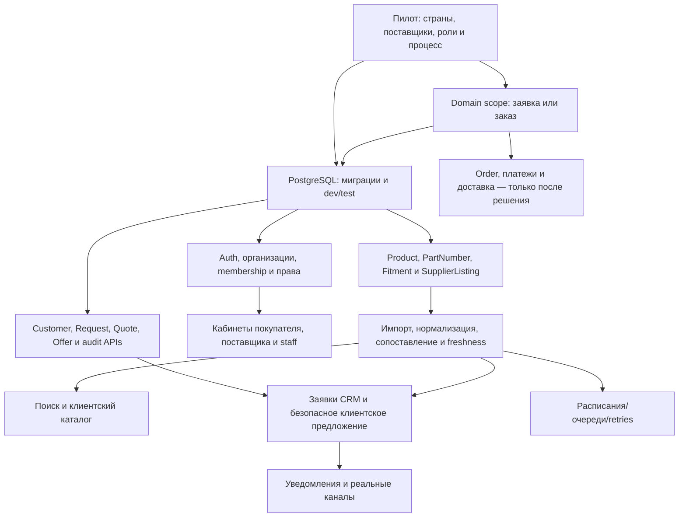

# ZAPTUT.PRO — единая функциональная карта продукта и план развития

Документ сводит клиентскую платформу, внутренние рабочие модули и общую инфраструктуру в один план. Он описывает целевую функциональность и фактическое состояние, не приравнивая экран или демонстрационные данные к работающей интеграции.

## Как читать статусы

- **Реализовано и проверено** — есть рабочая логика, а проверка отмечена в документах/журнале либо явно сообщена пользователем.
- **Реализовано в демо, целевой сценарий не проверен** — интерфейс и локальное поведение существуют, но нет оснований считать сценарий готовым для реальной работы.
- **Частично реализовано** — часть сценария работает в демо, его ключевые серверные, реальные или продуктовые части отсутствуют.
- **Не реализовано** — в коде/документации нет работающей реализации.
- **Зависит от решения** — реализация не должна начинаться до согласования описанного бизнес- или архитектурного решения.

Демо-данные, локальное состояние и статические изображения не являются реальными товарами, остатками, поставщиками, сообщениями, платежами или заказами.

## Фактическая исходная точка

- **Реализовано и проверено:** Next.js App Router, TypeScript, Tailwind и ESLint; русскоязычная главная и демо-категории отмечены как готовые в `docs/ROADMAP.md`. Для финансового демомодуля записаны тесты 15/15, успешные TypeScript и production build, а пользователь сообщил о прохождении ключевых браузерных сценариев ручной корректировки и отображения расчёта.
- **Реализовано в демо:** `/catalog` содержит набор демонстрационных товаров, клиентскую фильтрацию и форму-заглушку. `/admin` содержит рабочий стол, реестр/карточку заявки, поставщиков, клиентов, аналитику, финансовые настройки и демонстрационную работу с предложениями. Клиенты, поставщики, заявки и финансовые настройки частично сохраняются через `localStorage`.
- **Подтверждено только локально:** PostgreSQL 16 dev через Compose, baseline-миграция и Prisma repositories/services для Customer, Request/RequestItem, Supplier/Inquiry/Quote; unit-тесты и ограниченный DB integration test пройдены. Это не production-среда и не подключено к CRM UI.
- **Реализовано локально, не готово для production:** Better Auth вход/выход сотрудников, DB-backed sessions, роли/permissions и серверный guard `/admin`; подтверждены интеграционными тестами и локальным HTTP smoke. Нет полного security review, employee management UI и защищённых доменных API.
- **Не подтверждено для production:** production PostgreSQL/backup, защищённые доменные API и подключение CRM к ним, публичное хранение заявок, импорт поставщиков, синхронизация остатков, реальные предложения/заказы, платежи, доставка и каналы коммуникации.
- **Текущие основные файлы:** `src/app/page.tsx`, `src/app/catalog/page.tsx`, `src/app/admin/page.tsx`, `src/app/admin/requests/page.tsx`, `src/components/admin/request-register.tsx`, `src/components/admin/request-workspace.tsx`, `src/components/admin/supplier-registry.tsx`, `src/lib/customer-model.ts`, `src/lib/financial-config.ts`.

## A. Клиентская платформа

| Функция | Статус и фактическое состояние | Зависимости | Потребуемые страницы/модули |
|---|---|---|---|
| Главная и каталог | **Частично реализовано.** Главная и `/catalog` существуют; каталог показывает демонстрационный ассортимент. Каталог не получает актуальные предложения от поставщиков. | Каталог товаров, поставщицкие предложения, поиск. | `/`, `/catalog`; клиентский каталог и API выдачи. |
| Поиск VIN, OEM, артикула и названия | **Частично реализовано.** Переключатели VIN/OEM/название и поиск по локальному демо-набору есть. VIN не декодируется и не отправляется в реальный сервис; в главном блоке нет поиска по реальному индексу. | Нормализованные PartNumber, Vehicle/Fitment, каталог и поисковый индекс; для VIN — решение об источнике декодирования и правомерном использовании. | Компонент поиска; `/api/search`; домены каталога, номера детали и автомобиля. |
| Подбор автомобиля | **Частично реализовано.** На демо-карточках есть марки/модели/годы, а в каталоге — соответствующие фильтры. Нет полноценного выбора автомобиля, VIN-декодирования, поколений/двигателей и подтверждённой применимости. | Vehicle/Fitment, источники применимости, нормализованные товары; VIN-провайдер, если выбран. | Селектор автомобиля; `/vehicles`; сервис декодирования VIN при подтверждённом источнике. |
| Категории и фильтры | **Частично реализовано.** Категории и фильтры работают на демонстрационном наборе, а не на полном каталоге поставщиков. | Единая категория товара, опубликованные предложения, правила фильтрации и актуальности. | `/catalog`; фильтры каталожного API. |
| Карточки деталей и совместимость | **Частично реализовано.** Демо-карточка показывает фото, OEM, бренд, состояние и текстовое описание. Совместимость — демонстрационные диапазоны/заявления и не является проверенной гарантией. | Product, PartNumber, Fitment с источником/достоверностью; данные и подтверждения поставщика. | `/parts/[id]` или карточка в каталоге; Product/Fitment API. |
| Предложения поставщиков | **Частично реализовано.** В каталоге отображаются статические демонстрационные сведения; CRM умеет показывать/сравнивать демо-котировки. Реального потока от поставщиков нет. | SupplierListing/Quote, импорт или API поставщиков, источник и дата наблюдения, правила публикации. | Клиентская карточка предложения; каталог предложений; CRM-сравнение закупок. |
| Цена, наличие, состояние и срок | **Частично реализовано.** Эти поля присутствуют в демо-карточках и CRM-котировках. Цена может быть условной, наличие/совместимость не подтверждаются; нет актуальности `observed_at` и автоматического протухания в реальном каталоге. | Импорт/синхронизация, валюта и точные денежные типы, freshness policy, источник и `valid_until`. | Карточка детали/предложения; модель SupplierListing; проверка актуальности. |
| Корзина и оформление заявки/заказа | **Не реализовано; требуется решение о границе сценария.** Текущий продуктовый документ задаёт запрос на подбор с менеджером и прямо исключает checkout и оплату из первой версии. В текущем задании корзина/checkout названы целевыми функциями, но конкретные правила заказа не описаны. | Согласовать: корзина превращается в Request для менеджера или сразу в Order; цена/наличие и резервация; доставка, налоги и способы оплаты. | После решения: корзина, checkout/request review, Request/Order API. Не начинать реализацию до утверждения модели. |
| Отправка заявки на подбор | **Частично реализовано.** Демо-форма принимает поля на экране, показывает локальное подтверждение и прямо сообщает, что данные не отправлены/не сохранены. Реального endpoint и антиспама нет. | API, PostgreSQL, валидация, защита частоты/спама, согласие и политика контактов, связь с CRM и Customer. | `/request` или форма на `/catalog`; `POST /api/requests`; создание Request и RequestItem. |
| Личный кабинет покупателя | **Не реализовано.** Ссылки «Мои заявки» и профиль не ведут в аутентифицированный кабинет. | User/auth, customer account linkage, server authorization, backend requests/offers. | `/account`, профиль и список заявок; auth/session и customer API. |
| История заявок/заказов и отслеживание | **Не реализовано для покупателя.** Внутренняя CRM показывает демо-историю заявок; отдельной клиентской истории и статусов доставки/заказа нет. `Order` и доставка требуют отдельного доменного определения. | Customer account, persisted requests/offers; Order/fulfillment, события доставки и интеграции перевозчиков только после решения о заказе. | `/account/requests`, `/account/orders`, страница статуса; Order/Shipment модели после утверждения. |
| Уведомления и коммуникация с клиентом | **Не реализовано.** Демо-формирование предложения не отправляет сообщение наружу; каналы и подтверждение доставки не подключены. | Канал/поставщик сообщений, согласия и шаблоны, версионированное предложение, delivery status и аудит. | Notification service, экран предпочтений/уведомлений, customer offer delivery API. |

## B. Внутренняя платформа

| Функция | Статус и фактическое состояние | Зависимости | Потребуемые страницы/модули |
|---|---|---|---|
| CRM и обработка заявок | **Частично реализовано.** Демоконтур работает в интерфейсе; есть серверные Prisma repository/service для Request и RequestItem, а также auth/RBAC и защита `/admin`. Нет подключения интерфейса к БД, защищённых доменных API и production-аудита. | Защищённые API, demo Customer mapping, статусы/SLA и безопасные API boundaries. | `/admin`, `/admin/requests`, `src/lib/server/request-*`, server auth/RBAC, tasks/activity log. |
| Поставщики | **Частично реализовано.** Демо-реестр остаётся локальным; добавлены Prisma repository/service для Supplier, SupplierInquiry и SupplierQuote, независимые статусы, ActivityLog и серверная основа auth/RBAC. Нет подключения UI, кабинета организации/пользователя и внешней отправки запросов. | Защищённые supplier APIs, Organization/Membership, реальные контакты/условия и каналы отправки. | Внутренний `/admin`; `src/lib/server/supplier-*`; поставщицкие `/supplier/*` пока отсутствуют. |
| Единая база товаров | **Не реализовано.** Демо-каталог сайта и CRM quotes — разные наборы; канонические Product/PartNumber/Fitment и сопоставление предложений отсутствуют. | PostgreSQL-модель каталога; правила нормализации OEM/артикула/бренда и дедупликации; источники товара и применимости. | `products`, `part_numbers`, `fitments`, `supplier_listings`; импортный pipeline и каталог API. |
| Импорт прайсов | **Не реализовано.** CSV/XLSX upload, quarantine, preview, row errors и публикация версии не обнаружены. | Supplier cabinet/auth, форматные соглашения первых поставщиков, storage, нормализация и идемпотентность. | `/supplier/imports`, ImportJob/ImportRow, parser/validator, preview и публикация. |
| Запросы поставщикам, предложения и сравнение закупок | **Частично реализовано.** CRM поддерживает демо-котировки, их статусы, ручное редактирование, сравнение и выбор. Отдельный устойчивый `supplier_inquiry` с отправкой, дедлайнами, ответом и интеграциями не реализован. | Supplier accounts/contacts, inquiry channels, RequestItem, quote lifecycle, timestamps/validity, audit. | `/admin/requests/[id]` workspace; inquiry/quote service; supplier reply endpoint/portal. |
| Клиенты | **Частично реализовано.** Есть самостоятельная демо-модель Customer, связи `customerId`, миграция/поиск/редактирование и localStorage; есть Prisma repository/service и серверная auth/RBAC основа. UI не подключён к БД, защищённый Customer API и аккаунт покупателя не созданы. | Защищённый Customer API, demo-to-DB mapping, account linkage, privacy/retention and conflict policy. | Клиентский реестр `/admin`; `src/lib/server/customer-*`; `/account` после клиентской auth. |
| Финансы | **Частично реализовано.** В демо есть тарифы по странам, фиксированные курсы, расчёт точными minor units, ручные корректировки, причины/убыток/история и снимки предложения. Ручные сценарии проверены пользователем; данные хранятся в localStorage. Нет рыночных курсов, production ledger, платежей, налоговой и версии тарифов с серверным аудитом. | Утверждённая коммерческая/налоговая политика, источник и фиксация FX, backend storage, `numeric`/minor units, Order/Payment scope. | `/admin/finance`; financial config/service, quote snapshots, price history/audit; платежи — отдельный модуль после решения. |
| Аналитика | **Частично реализовано.** Есть демо-сводки по заявкам, странам предложений и текущим ответственным. Надёжные временные события, реальные продажи и оборот отсутствуют, поэтому часть метрик намеренно скрыта/помечена недоступной. | События с настоящими timestamps, семантика заказов/продаж, фильтр периода, валидные данные и определения KPI. | `/admin/analytics`; event facts/read model; позднее BI/reporting. |
| Сотрудники и роли | **Частично реализовано.** Есть Better Auth вход/выход, DB-backed сессии, SUPER_ADMIN/ADMIN/MANAGER/LOGISTICS, серверные permissions и per-user overrides; `/admin` проверяет сессию и `admin.access`; есть CLI bootstrap первого SUPER_ADMIN. Нет UI управления сотрудниками/назначения ролей, приглашений, tenant/organization scope и production hardening. | Employee management UI, Organization/Membership при multi-tenant scope, security review, защищённые domain APIs. | `/login`, `/api/auth/*`, `/admin/users` (нуждается в реализации), `src/lib/server/auth.ts`, `staff-session.ts`, `staff-rbac.ts`. |

## C. Общая инфраструктура

| Функция | Статус и фактическое состояние | Зависимости | Потребуемые модули |
|---|---|---|---|
| PostgreSQL | **PARTIAL.** Локальный PostgreSQL 16 работает через Compose с loopback-only портом и постоянным volume; `.env` содержит локальный `DATABASE_URL` и игнорируется Git. Baseline и auth/RBAC migrations применены; `migrate status`, Prisma Client, health endpoint и DB integration tests проверены. Production DB, backup/restore и перенос demo-данных отсутствуют. | Backup/restore, production deployment policy and controlled data migration. | `docker-compose.yml`, `prisma/schema.prisma`, `prisma/migrations`, `src/lib/server/*-repository.ts`, `src/lib/server/db.ts`. |
| Серверные API и поиск | **PARTIAL.** `/api/health` реально возвращает HTTP 200 при доступной БД. Внутренние Customer/Request/Supplier/Quote repositories/services и auth/RBAC покрыты тестами; защищённые доменные API ещё не созданы. Поиск сайта остаётся клиентским по демоданным. | Auth guard уже имеется; нужны tenant/data boundaries, Customer API и затем остальные PII APIs; канонический каталог и query semantics для VIN/OEM/part/name. | `/api/health`, `/api/auth/*`; следующие защищённые customer/request/supplier APIs; `/api/search` после каталога и метрик. |
| Авторизация и права доступа | **Частично реализовано и локально проверено.** Better Auth credentials login/logout, Prisma-backed sessions, HttpOnly cookies, rate limit, CSRF origin checks, роли и permission checks на сервере; `/admin` требует сессию и `admin.access`. Не реализованы employee management UI, organization/tenant scope и production security review; CRM данные остаются в localStorage. | Employee administration, tenant model if required, security/privacy review and protected domain API coverage. | `/login`, `/api/auth/*`, `/admin` server layout; `src/lib/server/auth.ts`, `staff-session.ts`, `staff-rbac.ts`; будущий `/admin/users`. |
| Хранилище изображений и документов | **Частично реализовано только для статических ресурсов.** Изображения сайта размещены как готовые файлы в `public`; пользовательских загрузок, документов поставщиков и object storage нет. | Выбор провайдера/хранения, метаданные/ownership, ограничения типов/размеров, контроль доступа и retention. | Media/document service, signed upload/download, связи с Product/Supplier/ImportJob/Request. |
| Интеграции поставщиков RU/BY/PL | **Не реализовано.** Поставщики и цены в CRM — демоданные/ручные записи; API/фиды и согласованные форматы не подключены. | Список пилотных поставщиков, их форматы и договорённости, credentials/secret management, каноническое сопоставление и freshness. | Adapters/importers per supplier; сначала ручные CSV/XLSX по `docs/ROADMAP.md`. |
| Allegro.pl | **Не реализовано; исследование отложено.** Документация разрешает рассматривать только официальный API после правовой и технической проверки; скрейпинг исключён. | Legal/API terms, account/access eligibility, коммерческие условия, mapping и data policy. | Отдельный discovery, затем официальный adapter только при положительном решении. |
| Фоновые задачи и синхронизация | **Не реализовано.** Нет расписания импортов, очередей, повторов и синхронизации остатков. | Поставщицкие источники, idempotent import pipeline, job state, failure policy, объем и SLA. | ImportJob worker/scheduler/retry queue; при росте нагрузки — очередь фоновых задач. |
| Уведомления | **Не реализовано как отправка.** CRM хранит внутренние события; SMS/email/прочие внешние каналы не настроены. | Выбранные каналы, шаблоны, consent, очереди, delivery tracking и audit. | Notification service/templates/outbox; клиентские и staff preferences. |
| Платежи и доставка | **Не реализовано.** Платежей, checkout, заказов и интеграций перевозчиков нет. Сроки/стоимость поставщика вводятся в демо-котировках, это не доставка покупателю. | Сначала решение по order/checkout; затем страны, налоги, валюты, способы оплаты, возвраты, перевозчики/зоны и ответственность за обещания. | Order/Payment/Fulfillment, provider adapters, customer tracking. |
| Аудит, наблюдаемость, privacy и production operations | **Частично описано, не реализовано как production-контур.** Требования есть в архитектуре/CRM-моделях, но нет серверного append-only журнала, read-audit, retention, мониторинга или recovery. | Production DB/auth, threat model, privacy/legal review, data retention, backup/restore plan, operational ownership. | Activity/audit service, metrics/logging/alerts, retention/export/delete, backup and incident runbooks. |

## Сквозные требования из действующей документации

Эти требования нужно сохранять при реализации соответствующих модулей:

- Одна заявка содержит несколько позиций; у позиции может быть несколько независимых supplier inquiries/quotes; клиентская версия предложения выбирает варианты по позициям и сохраняет неизменяемый снимок условий.
- Статусы заявки не заменяют статусы запроса/ответа поставщика и клиентского предложения. Локально сформированное предложение не считается отправленным; подтверждённая заявка сама по себе не равна завершённому заказу/продаже.
- В клиентское предложение/API не попадают закупочные цены, контакты поставщика, внутренние заметки и закрытые источники. Ограничение должно быть серверным allowlist, а не только скрытием полей UI.
- Совместимость, цена, наличие и срок имеют источник и временную актуальность; неоднозначную применимость нужно подтверждать вручную, наличие не обещать без свежего подтверждения.
- Клиенты связываются с заявками постоянным `customerId`; исторические контактные снимки заявки не переписываются при изменении профиля. Сопоставление телефона/email не должно объединять неоднозначные профили автоматически.
- Денежные суммы хранятся вместе с валютой и без binary float. Для демо утверждено: Польша — 55% и минимум 1 700 RUB на каждую деталь; Россия/Беларусь — 28% и минимум 300 RUB на каждую деталь. Логистика «за штуку» и «за заказ» учитывается раздельно; ручная цена заменяет цену позиции и требует причины, а ниже закупки — подтверждения и объяснения. Production курсы/тарифы должны быть источником с авторством/временем и фиксироваться в снимке.
- VIN и контакты — чувствительные персональные данные: нужны доступ по ролям, сроки хранения, экспорт/удаление, audit и проверка трансграничной передачи до production.
- Импорт должен идти через загрузку/карантин, проверку формата, нормализацию, сопоставление, preview/ошибки, идемпотентную публикацию версии и фиксацию источника/времени получения.

## Противоречия, дубли и устаревшие формулировки в существующих документах

1. **`README.md` отстаёт от продукта:** описывает только стартовую главную и говорит, что поиск/заявки не связаны, почти не упоминая существующий каталог и CRM-демо. Это не конфликт по production-готовности, но неполное описание текущих demo-модулей.
2. **`docs/PROJECT-STATE.md` содержит устаревшую последнюю задачу:** в шапке/конце написано про восстановление dev-сайта, тогда как более поздние записи `AI-LOG` и `AI-HANDOFF` фиксируют финансовую проверку и ручные сценарии. Внутри одной сводки статусы расходятся.
3. **`docs/CRM-WORKFLOWS.md` устарел относительно финансового хранения:** раздел реализации утверждает, что настройки и корректировки сбрасываются после перезагрузки, но `PROJECT-STATE` и пользовательская проверка утверждают сохранение ручных цен/истории в `localStorage` после F5. Аналогично верхний текст про «память вкладки» не описывает локальную persistence всех модулей одинаково.
4. **CRM-реализация дублируется в документах:** `PROJECT-STATE`, `CRM-WORKFLOWS` и `CRM-DATA-MODEL` каждый описывают demo CRM, но разными уровнями и разными датами. Целевую модель ошибочно легко принять за действующую базу; в `CRM-DATA-MODEL` это корректно предупреждено.
5. **Финансовые правила описаны подробно в `CRM-FINANCIAL-LOGIC.md`, но часть production требований дублируется** в `ARCHITECTURE.md`, `CRM-DATA-MODEL.md` и `CRM-WORKFLOWS.md` (аудит, права, snapshots, privacy). В этой карте они сведены в сквозные требования без замены исходных документов.
6. **Checkout/оплата — явный scope conflict:** новый запрос включает корзину/checkout/платежи, но `PRODUCT.md` исключает checkout и оплату из первой версии, а `ROADMAP.md` не ставит их в MVP. До оценки/разработки нужно решить, остаётся ли продукт менеджерским агрегатором заявок или включает прямую покупку.
7. **Кабинет поставщика, импорт и каталог повторяются между** `PRODUCT.md`, `ARCHITECTURE.md`, `DATA-MODEL.md`, `CRM-DATA-MODEL.md` и `ROADMAP.md`. Это одна связанная capability chain, а не пять независимых продуктов: профили/доступ → импорт → нормализация и сопоставление → публикация актуального listing → поиск.

Отдельного второго файла с roadmap/планом в `docs/` не найдено: текущая поэтапная дорожная карта — `docs/ROADMAP.md`; остальные документы задают требования и целевую архитектуру.

## Архитектурные зависимости и блокеры

Главные блокирующие зависимости: не утверждены география и операционный пилот; прямой checkout конфликтует с существующей менеджерской моделью; без схемы/БД нельзя безопасно сделать общую базу товаров и устойчивую CRM; базовый staff auth/RBAC уже есть, но кабинеты покупателей/поставщиков, tenant membership и защищённые доменные API ещё нужны для разграничения их данных; без канонического каталога импорт не может надёжно объединять строки и выдавать применимость.

## Рекомендуемые пять приоритетов

1. **Утвердить границы пилота:** страны и первые поставщики; роли команды; процесс менеджера; какие предложения публичны; является ли итогом заявка на подбор или прямой заказ; включаются ли платежи/доставка в первый запуск.
2. **Создать production foundation:** PostgreSQL schema/migrations и dev/test окружение для Customer, Request, RequestItem, Supplier, Inquiry, Quote, Offer, Task и Audit; определить API и единственную серверную модель persistence.
3. **Завершить безопасный CRM-контур:** реальная форма заявки → очередь/карточка → назначение/задачи → отдельные inquiries/quotes → версия клиентского предложения → только фактическая отправка → ответ/итог. Расширить существующий staff auth/RBAC защищёнными API, tenant isolation там, где нужны организации, privacy и серверным аудитом до доступа реальных пользователей.
4. **Построить каталог поставок:** supplier profile/access и согласованный ручной CSV/XLSX импорт с quarantine, preview и row errors; Product/PartNumber/Fitment/SupplierListing; идемпотентное сопоставление и timestamp/freshness.
5. **Подключить клиентский путь на реальных данных:** поиск и фильтры по опубликованным listings, VIN/автомобильная применимость по подтверждённым источникам, карточка/предложения, отправка запроса и кабинет/статус обращения. Добавлять checkout только если это утверждено в приоритете 1.

## Последовательность от текущего состояния до полноценного запуска

1. **Scope и пилотное решение.** Зафиксировать рынки, первые поставщики и форматы, менеджерский процесс, SLA, юридические/операционные ограничения, customer request vs order, оплата и доставка.
2. **Доменная и платформенная основа.** Свести концептуальные модели, определить миграции PostgreSQL, ограничения/FK/индексы, dev/test seed, API boundaries, секреты, backup/restore и CI-проверки.
3. **Безопасное хранение и доступ.** Реализовать Users/Organizations/Memberships, server-side RBAC и изоляцию, privacy policies для VIN/контактов, retention/export/delete, append-only audit. Сначала закрытый staff-контур.
4. **Production request/CRM loop.** Серверная форма с validation/rate limiting → Customer/Request/RequestItems → реестр/карточка/задачи/история → supplier inquiries и quotes → снимки и сравнение → безопасная версия предложения → подключённый канал отправки и отдельный статус ответа.
5. **Поставщицкая база и импорт.** Профили/проверка поставщика → ручной импорт первых согласованных форматов → quarantine/preview/errors → нормализация → сопоставление каталога → публикация и время актуальности.
6. **Единый каталог и поиск.** Canonical Product/PartNumber/Fitment/Vehicle, фильтры, карточки реальных предложений, совместимость с источником/достоверностью, валидность цены/наличия; VIN интеграция только по выбранному законному источнику.
7. **Клиентский аккаунт и уведомления.** Аккаунт, обращения/версии предложений, уведомления и tracking событий. Заказ, корзина, платежи и перевозчики добавляются только после утверждения scope и договорённостей.
8. **Пилотная эксплуатация.** Метрики обработки, мониторинг импортов и SLA, тестирование ролей/тенантов и утечек, резервное восстановление, поддержка, политика ошибок/возвратов и ручной fallback.
9. **Масштабирование.** Фоновые очереди и retries по объёмам, новые страны/валюты и локальные правила; исследование официального Allegro API; поисковая индексация по измерениям реального трафика.

## Что пока не делать

- Не подключать Allegro или иной внешний API до правовой/технической проверки, доступов и утверждённых условий.
- Не строить поисковую инфраструктуру/индекс до появления канонических данных и измерения реальной нагрузки.
- Не делать checkout, платежи, резервацию или обещание остатка, пока не определены Order flow, ответственность за наличие, доставка, налоги, возвраты и коммерческие правила.
- Не создавать фоновую очередь для несуществующего импорта; сначала согласовать форматы, реализовать идемпотентный импорт и измерить объёмы.
- Не считать статический каталог, локальную CRM, ручные котировки и demo FX готовой интеграцией или production-аудитом.

## Источники

Карта составлена по `README.md`, `docs/PROJECT-STATE.md`, `docs/AI-LOG.md`, `docs/AI-HANDOFF.md`, `docs/ROADMAP.md`, `docs/PRODUCT.md`, `docs/ARCHITECTURE.md`, `docs/DATA-MODEL.md`, `docs/CRM-DATA-MODEL.md`, `docs/CRM-WORKFLOWS.md`, `docs/CRM-FINANCIAL-LOGIC.md`, а также фактическим маршрутам и компонентам `src/app` и `src/components/admin`. Пользовательские браузерные проверки отделены от самостоятельных автоматических проверок.

## D. Заказы и исполнение — обязательные требования по референсам izap24.ru

Этот раздел дополняет карту требованиями трёх предоставленных скриншотов. Он описывает целевую функциональность ZAPTUT.PRO, а не переносит старую компоновку или визуальный стиль референса. Статусы ниже оценивают именно сценарии заказов/исполнения; похожая функция у CRM-заявок не считается готовым заказом. Это дополнение делает заказ, оплату и доставку обязательными направлениями полного продукта, хотя детали коммерческого процесса всё ещё требуют фиксации до реализации.

| Функция | Статус | Фактическое состояние / объём требования | Зависимости | Потребуемые страницы/модули |
|---|---|---|---|---|
| Реестр заказов и поиск по номеру | **PARTIAL.** Есть реестр заявок CRM с поиском и фильтрами; отдельного реестра заказов и модели Order нет. | Заказ должен иметь собственный номер и искаться независимо от заявки. | Модель Order и связь Request → Order; PostgreSQL/API; статусы и права. | `/admin/orders`, фильтры/очереди, Order API и read model. |
| Очереди заказов по статусу и следующему действию | **PARTIAL.** В CRM есть очереди заявок и задачи, но нет заказных очередей оплаты, выкупа и доставки. | Очереди: новые, в работе, ожидание оплаты, выкуп, доставка, завершённые, отменённые; отдельные очереди действий — запрос поставщику, подбор, ответ клиенту. | Order lifecycle; supplier inquiry и task lifecycle; deadline/SLA; аудит. | `/admin/orders`, рабочий стол заказов, очередь действий и фильтры. |
| Сводка строки заказа и быстрые действия | **PARTIAL.** CRM показывает демо-покупателя, позиции, ответственного, статус и комментарии заявки; заказных сумм/платежей и действий с документами нет. | В строке: клиент, товары, сумма, оплата, комментарий менеджера. Действия: редактировать, печатать накладную, выставить счёт, дублировать. Разделение очередей по направлению/стране применяется, если оно соответствует утверждённым бизнес-процессам. | OrderItem/Payment; генерация документов; country/direction policy; RBAC. | Таблица `/admin/orders`, action menu, invoice/waybill service. |
| Полная карточка заказа | **PARTIAL.** Существует подробная карточка CRM-заявки с клиентом, автомобилем, позициями, менеджером, внутренними заметками и историей. Это не карточка заказа и в ней не реализован полный delivery/order lifecycle. | Номер, дата, источник, история, способ доставки, адрес, индекс, трек, статус и тип запроса, клиент и менеджер, причина отказа и комментарии, отдельные сведения логистике; редактирование параметров с неизменяемой историей изменений. | Order/OrderItem; Customer; Shipment; авторизованные роли; append-only audit. | `/admin/orders/[id]`, секции заказа/логистики/истории и отдельная проекция для логистики. |
| СДЭК и расширяемая доставка | **NOT IMPLEMENTED.** В CRM нет интеграции перевозчика; срок поставщика и ручное поле трек-номера не являются доставкой. | Расчёт цены/срока, выбор тарифа и получения, ПВЗ или курьер, создание отправления через официальный API СДЭК, хранение номера накладной, генерация/печать документов, получение и автоматическое обновление статусов, tracking, клиентские уведомления с возможностью отключить конкретное уведомление, история отправлений. Архитектура должна допускать другие службы доставки через адаптеры. | Order и адрес; договор/API доступ, тарифы/география; carrier adapter; background jobs, webhook/polling, notification outbox, документы и audit. | `/admin/orders/[id]/delivery`, клиентское отслеживание, `Shipment`/`ShipmentEvent`, CDEK adapter и общий carrier interface. |
| Email и история коммуникаций | **PARTIAL.** Есть внутренние CRM-события/заметки и локально сформированное предложение; реальной отправки email нет. | Настраиваемые почтовые серверы; шаблоны быстрых сообщений; редактор; вложения фото/файлов; внутренние сообщения, недоступные клиенту; полная история переписки в заказе и профиле клиента; состояния отправки и ошибки/повторы. Внутренние заметки, закупка и контакты поставщика исключаются из клиентской проекции. | Auth/RBAC; consent/contact policy; message outbox; storage/scanning файлов; provider configuration/secret management; аудит и allowlist DTO. | Коммуникационная панель заказа и клиента; `/admin/settings/email`; Message/Attachment/DeliveryAttempt; почтовый adapter. |
| Заметки, задачи, напоминания | **PARTIAL.** В CRM есть внутренние заметки и рабочие задачи; полнота именно заказных напоминаний, категорий, назначений, уведомлений по сроку и истории выполненных/просроченных задач не подтверждена. | Заметка заказа с категорией; дата/время напоминания и ответственный; запрос поставщику из контекста заказа; очередь задач менеджеров, уведомление при наступлении срока, история выполненных и просроченных задач. | Order; Task/Reminder; часовой пояс и SLA; уведомления; история действий. | Панель задач заказа, `/admin/tasks`, Task/Reminder service и scheduler. |
| Запросы поставщикам из заказа | **PARTIAL.** В карточке заявки есть демонстрационные предложения и их статусы; фактические запросы/ответы поставщикам не отправляются. | Отдельный inquiry на каждую товарную позицию; связь с заказом и товаром; независимый статус, срок ответа, история запроса/ответа, полученные цена/наличие/условия и внутренняя заметка. | OrderItem/RequestItem; Supplier; каналы связи/кабинет; сроки и audit. | Раздел sourcing в карточке заказа; `SupplierInquiry`, `SupplierQuote`, supplier portal/API. |
| Счета, накладные и документы | **NOT IMPLEMENTED.** Интерфейсные действия/текст о предложении не означают создание или хранение документа. | Счёт, накладная, документы перевозчика и печатная форма заказа; скачать и повторно распечатать; хранить версию и событие в истории заказа; доступ ограничивать ролями. | Order/Payment/Shipment; шаблоны и юридические реквизиты; файловое хранилище; RBAC и audit. | `/admin/orders/[id]/documents`, Document/DocumentVersion storage и генератор печатных форм. |
| Позиции заказа и финансовая таблица | **PARTIAL.** В демо CRM рассчитываются финансовые показатели котировок/выбранного предложения, но полноценной редактируемой таблицы заказа с налогом и историей строк нет. | На каждую строку: товар, артикул, статус, срок обработки, количество, цена/единица, сумма, налог, закупка, логистика, наценка, валовая прибыль и маржинальность; добавление/удаление с аудитом. Не менять утверждённые тарифы и формулы ZAPTUT.PRO. Политика и ставка налога не заданы и требуют отдельного решения; ставку не предполагать. | OrderItem; неизменяемые финансовые snapshots; утверждённые финансовые правила; tax policy; точные денежные типы и валюты. | Таблица позиций `/admin/orders/[id]`, calculation service, price/FX snapshots и audit. |
| Разделение заявки, заказа, оплаты и исполнения | **NOT IMPLEMENTED.** Текущий домен CRM описывает Request и клиентское предложение; отдельные сущности заказа, платежа и отправления не подтверждены. Подтверждение заявки не равно продаже или завершённому заказу. | Явно фиксировать переход от запроса/предложения к заказу, жизненные циклы оплаты и исполнения, причины отмены/отказа и историю изменений. Клиентские и внутренние статусы остаются раздельными. | Решение по переходу Request → Order, коммерческий процесс стран, Order/Payment/Shipment модели, роли и аудит. | Domain services и события переходов; `/admin/orders`; клиентская история заказов после реализации кабинета. |

### Обязательные зависимости и безопасные границы

1. **Request не подменяет Order.** Подтверждённое клиентом предложение/заявка — основание для следующего бизнес-перехода, но не доказательство оплаты, выкупа, отправки или продажи. Нужны самостоятельные статусы и события каждого агрегата.
2. **Серверная защита клиентских сообщений и документов.** В клиентское сообщение/предложение/вложение нельзя включать закупочные цены, контакты поставщиков и внутренние заметки. Фильтрация только в интерфейсе недостаточна; нужна серверная allowlist-проекция и проверка доступа.
3. **Внешние действия подтверждаются каналом.** Нельзя отмечать письмо как отправленное без успешного результата почтового адаптера. Трек-номер, введённый вручную, не доказывает создание отправления СДЭК; статус доставки должен происходить из интеграции и сохраняться как событие.
4. **Снимки и история.** Изменение адреса, позиции, курса/цены, параметров доставки или документа не должно бесследно перезаписывать предыдущие значения. Для счёта, клиентской цены и условий, показанных клиенту, фиксируются версии; текущие утверждённые финансовые правила остаются источником расчёта новых версий.
5. **Неопределённые операционные параметры — блокеры детализации, а не причины убрать требования.** До подключения оплаты/доставки нужно согласовать страны и зоны, тарифы, налоговую политику, возвраты, оплату, адресные правила, сроки хранения документов и кто отвечает за обещание наличия/срока.

### Обновлённая последовательность реализации заказного контура

1. Зафиксировать Order lifecycle и его переход из Request/принятого предложения; определить статусы оплаты, выкупа, исполнения, отказа и отмены, роли и SLA. Утвердить страны/направления, налоги, доставку, оплату и правила документов.
2. Расширить production-модель PostgreSQL и API: Order, OrderItem, Payment/PaymentEvent, Shipment/ShipmentEvent, Document/DocumentVersion, Message/Attachment/DeliveryAttempt, Reminder/Task и связи с Customer, Request, Supplier, Product. Определить транзакции, idempotency, snapshots и audit.
3. Реализовать закрытый внутренний реестр и карточку заказа, очереди действий, поиски/фильтры, назначение менеджера, позиции и редактирование с аудитом. Разделить заявки CRM и заказы в навигации и аналитике.
4. Реализовать реальные supplier inquiries и сохранение предложений на позиции заказа; затем таблицу расчёта заказа с утверждённой финансовой логикой и отдельно согласованной налоговой политикой.
5. Добавить документы и коммуникации: счета/печатные формы, доступ к версиям, конфигурация email, шаблоны, вложения, внутренние сообщения, outbox, статусы доставки и обработка ошибок.
6. Подключить платёжный поток после выбора способов и правил оплаты; связать фактические события оплаты с очередями «ожидает оплаты» и «выкуп».
7. Внедрить общий carrier interface и затем официальный адаптер СДЭК: тарифы/сроки, ПВЗ/курьер, создание отправления, документы, события tracking и уведомления. После проверки архитектуры и договорённостей добавлять другие службы.
8. Открыть клиенту кабинет заказов/отслеживание и коммуникации только после server-side auth/ACL, безопасных проекций данных и проверки уведомлений. Провести end-to-end тесты, включая повторы, ошибки интеграций, отмены и повторную печать документов.

Эти этапы дополняют общие этапы выше: базовая БД, авторизация и аудит остаются предпосылками. До готовности настоящего Order/Shipment/Payment pipeline CRM-заявки и локальные демо-котировки не должны отображаться как реальные заказы, оплата или доставка.
